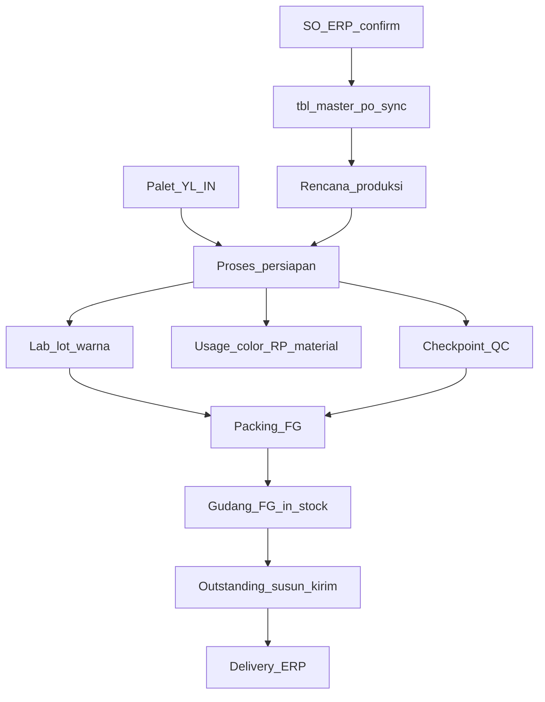

# Peta fungsi MRP shopfloor (yang sudah ada)

Inventaris fungsi yang sudah jalan di UI Vue + API Flask MRP (`tonghong_mrp`), di-proxy FastAPI [`backend/app/routers/mrp_gateway.py`](../backend/app/routers/mrp_gateway.py). Bukan backlog fitur baru.

**Stack:** frontend `/admin/mrp/*` → FastAPI `/api/v1/mrp/...` → Flask [`mrp/api_routes.py`](../mrp/api_routes.py) (port 5010). HTML Flask lama di-retire (`mrp/app.py` `_retire_flask_html_ui`).

Lihat juga: [menu-erp-mrp-status.md](menu-erp-mrp-status.md), [adr-erp-only-masters.md](adr-erp-only-masters.md), [uat-mrp-sl043-hasil.md](uat-mrp-sl043-hasil.md).

## Dual path (jangan campur)

- **MRP** = operasi shopfloor harian (menu `mrpFlowMenus` di [`frontend/src/layouts/AdminLayout.vue`](../frontend/src/layouts/AdminLayout.vue)).
- **ERP** Production / QC / Packing = buku order + bridge, bukan lantai produksi.
- Master katalog MRP (kecuali Treatment) = **lihat saja** dari ERP `master_items` / `raw_materials`. CRUD di Inventory.

## Alur utama (urut operasi)

### 0. Prasyarat: SO confirm → `tbl_master_po`

- Confirm SO ERP memanggil sync [`backend/app/services/mrp_po_sync.py`](../backend/app/services/mrp_po_sync.py) → `POST /api/mrp/masters/po/sync`.
- Field penting: `no_so`, `no_po` (PO customer), `lot_number` (dari `thi_line_ref`), qty, spek, `source_detail_id`.
- Status PO MRP: outstanding / partial / completed (`qty_processed` vs `qty_order`).

### 1. Rencana Produksi — `/admin/mrp/rencana-produksi`

UI: [`MrpRencanaProduksiPage.vue`](../frontend/src/views/admin/mrp/MrpRencanaProduksiPage.vue) + [`MrpRencanaCreateDialog.vue`](../frontend/src/views/admin/mrp/MrpRencanaCreateDialog.vue).

Fungsi yang ada:

- Sync senyap + daftar rencana (`GET /rencana`).
- Buat rencana dari **SO outstanding** (bukan cascade color swatch): pilih baris PO, isi qty rencana ≤ sisa alokasi (`POST /rencana`).
- Detail item: kode RPI, `kode_lot_wip`, spek, alokasi PO, sisa rencana vs sisa kirim ERP.
- Ganti/replace alokasi PO per item (`GET/POST /rencana/item/:id/list-po`).
- Cetak rencana, barcode item.
- 1 baris SO = 1 item rencana (via `po_lines`).

Hasil: `tbl_rencana_produksi` + `tbl_rencana_item` + `tbl_rencana_item_po`. Item punya **RPI** dan **WIP**.

### 2. Palet / YL — `/admin/mrp/palet` (bahan untuk proses)

Fungsi: palet IN, daftar YL per palet, YL OUT / movement. Stok YL dikurangi saat **Selesai KY** di proses.

API: `GET/POST /palet`, `/palet/in`, `/palet/out`, `/yl`, movements.

### 3. Proses / Persiapan kulit — `/admin/mrp/proses`

UI: [`MrpProsesPage.vue`](../frontend/src/views/admin/mrp/MrpProsesPage.vue) + [`MrpProsesDetailPage.vue`](../frontend/src/views/admin/mrp/MrpProsesDetailPage.vue).

Fungsi yang ada:

- Scan / pilih RPI, pilih treatment (PU/Suede dari master treatment), buat persiapan (`POST /proses`).
- Status: `draft` → **Start** → `started` → **Selesai & Simpan** → `saved`/`completed`.
- Sesi KY (hanya setelah Start): palet + YL + target qty; **Selesai KY** memotong stok YL (`_consume_yl_for_ky_session`).
- Pencatatan ukur per sesi (tambah/hapus).
- Cetak stiker lot WIP / reprint.

API aksi [`proses_actions`](../mrp/api_routes.py): `start`, `scan_ky`, `add_ukur`, `selesai_ky`, `delete_ukur`, `save`, `reprint`.

Gate: Lab (jika di-link RPI) butuh persiapan `started|saved|completed`. Packing butuh persiapan `saved|completed`.

### 4. Lab lot warna — `/admin/mrp/lab`

- Buat lot mixing + baris kimia.
- Link RPI opsional; ditolak jika belum ada persiapan aktif.
- Dipakai nanti di Usage Color.

### 5. Usage — `/admin/mrp/usage`

Tiga tab: Color (scan lot lab), RP (scan master RP), Material lain. Qty ke WIP; opsional potong lot stok shopfloor (kimia / RP / material).

### 6. Checkpoint — `/admin/mrp/checkpoint`

- Scan WIP, pilih treatment master atau QC OK/NG, tebal aktual.
- Update `checkpoint_status` di persiapan; bisa link QC ERP.
- **Wajib QC OK** sebelum Finish packing (`_wip_has_checkpoint_ok`).

### 7. Packing FG — `/admin/mrp/packing`

- Scan WIP (persiapan saved/completed), pilih PO, mulai packing.
- Header softness/berat; tambah/hapus roll (lembar + ukuran); alokasi PO packing.
- Cetak packing list.
- **Finish → Gudang FG**: min 1 roll + checkpoint QC OK → `tbl_gudang_fg` `in_stock`.

### 8. Gudang FG — `/admin/mrp/gudang-fg`

- Daftar in_stock / OUT, detail, bridge status ke Delivery ERP.
- UI **tidak** membuat surat jalan dari halaman ini: tombol **Buka Outstanding**.
- `POST /gudang-fg/out` lewat gateway ditolak (`FG_OUT_MUST_USE_OUTSTANDING`).
- Jalur kirim: **Outstanding susun kirim** memicu FG OUT + Delivery ([`mrp_fg_delivery_bridge.py`](../backend/app/services/mrp_fg_delivery_bridge.py) / `apply_outstanding_ship_batch`).

Setelah OUT: Delivery ERP → sent → invoice (manual, di luar MRP).

## Material & master (pendukung, bukan urutan shopfloor)

**Stok shopfloor** (IN lot / OUT + sisa):

- Kimia `/admin/mrp/stok-kimia` — OUT bisa bridge stok ERP.
- RP `/admin/mrp/stok-rp`
- Material lain `/admin/mrp/stok-material-lain`

**Master MRP:**

- Item ERP, Kulit, Kimia, RP, Material lain = read-only dari ERP.
- Treatment = CRUD di MRP (jenis PU/Suede untuk proses + opsi checkpoint).

**Laporan:** Report Packing, Report Persiapan (`GET /reports/packing`, `/reports/persiapan`).

## File acuan

- API: [`mrp/api_routes.py`](../mrp/api_routes.py), schema [`mrp/schema.sql`](../mrp/schema.sql)
- Gateway: [`backend/app/routers/mrp_gateway.py`](../backend/app/routers/mrp_gateway.py)
- Sync SO: [`backend/app/services/mrp_po_sync.py`](../backend/app/services/mrp_po_sync.py)
- FG → Delivery: [`backend/app/services/mrp_fg_delivery_bridge.py`](../backend/app/services/mrp_fg_delivery_bridge.py)
- UAT alur lengkap: [uat-mrp-sl043-hasil.md](uat-mrp-sl043-hasil.md) (M0–M9)

## Yang tidak termasuk MRP

ERP Production/QC/Packing halaman admin; invoice AR; Delivery SJ. MRP berhenti di FG in_stock / OUT ke delivery draft.
